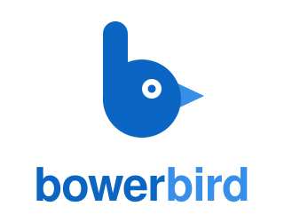

<h1 align="center">
  
</h1>

<p align="center">
  <b>Collects the CVs of applicants to your LinkedIn job posts and arranges them in one folder per job.</b>
</p>

<p align="center">
  <a href="https://www.python.org/downloads/"></a>
  <a href="LICENSE"></a>
</p>

bowerbird is a command-line tool and Python library that downloads the CVs of applicants to your LinkedIn job posts, and exports the description and details of any public job post. It is named after the bowerbird, which gathers objects and arranges them neatly.

```bash
bowerbird                  # download every new CV from every open job post
bowerbird --jd 1234567890  # export a job description; no login required
```

It works with the standard LinkedIn hiring dashboard (`linkedin.com/hiring`). LinkedIn Recruiter is not supported.

> [!WARNING]
> This is an unofficial client that uses LinkedIn's private, undocumented requests. LinkedIn's terms of service prohibit automated access, and an account that uses this tool can be restricted. LinkedIn can change these requests at any time, which stops the client until it is updated. Read [Risks and limitations](#risks-and-limitations) before you use it.

## Features

- **One command for every applicant.** Finds your open job posts and downloads each applicant's CV as a PDF, across the In Review, Shortlist and Rejected stages.
- **Incremental.** CVs already on disk are skipped, so each run downloads only new applicants.
- **No cookie handling.** You sign in once in a dedicated Chrome window. The session is stored locally and reused.
- **Job descriptions without login.** Exports the title, company, location, criteria and full description of any public job post.
- **Two paces.** A quick pace for interactive use and a slow pace for unattended runs.
- **Built for scheduling.** A single command runs nightly, stops at a set time and resumes the next night.
- **Read-only.** It never rates, shortlists, rejects or messages an applicant.
- **Small.** One Python file with one dependency.

## Table of contents

- [Requirements](#requirements)
- [Installation](#installation)
- [Quick start](#quick-start)
- [Command-line reference](#command-line-reference)
- [Python API](#python-api)
- [Job descriptions](#job-descriptions)
- [Pacing and scheduled runs](#pacing-and-scheduled-runs)
- [Output](#output)
- [Running on a Linux server](#running-on-a-linux-server)
- [Using your own network from a server](#using-your-own-network-from-a-server)
- [How it works](#how-it-works)
- [Troubleshooting](#troubleshooting)
- [Risks and limitations](#risks-and-limitations)
- [License](#license)

## Requirements

| Requirement | Notes |
|---|---|
| Python 3.11 or newer | |
| Google Chrome | Required for CV downloads. Not required for job descriptions. |
| A LinkedIn account that owns the job posts | Required for CV downloads only. |
| A display | The client runs a regular Chrome window. On a Linux server without a monitor it starts a virtual display automatically. See [Running on a Linux server](#running-on-a-linux-server). |

## Installation

```bash
pip install git+https://github.com/RubinRazaa/bowerbird
```

This installs the `bowerbird` command and the `bowerbird` Python module.

To install from a local copy of the repository, run `pip install .` in its folder. To run from a copy of the repository without installing, replace `bowerbird` with `uv run bowerbird` in any command below.

## Quick start

**1. Sign in once.**

```bash
bowerbird --login
```

A Chrome window opens on LinkedIn. Sign in, complete any verification LinkedIn requests, confirm that **Manage job posts** lists your jobs, and close the window.

The session is stored in `~/.bowerbird/` and reused by every later run. It is separate from your regular Chrome profiles.

**2. Run a small test.**

```bash
bowerbird --limit 3
```

```
1 job posts: 1234567890
job 1234567890: 12 applicants, 3 to download
  saved Jane_Doe_30000000001.pdf
  saved Sam_Lee_30000000002.pdf
  saved Ana_Silva_30000000003.pdf
done: 3 CVs saved under cvs/
```

**3. Download everything.**

```bash
bowerbird
```

Run `--login` again only when LinkedIn ends the session, or to change accounts: sign out in that window, then sign in with the other account.

## Command-line reference

```
bowerbird [JOB_ID ...] [options]
```

| Argument or option | Description |
|---|---|
| `JOB_ID ...` | Job posts to process, as job IDs or job links. Default: every job on the **Open** tab. |
| `--out DIR` | Output folder. Default: `./cvs`. |
| `--limit N` | Download at most `N` new CVs per job. |
| `--slow` | Use the slow pace. See [Pacing and scheduled runs](#pacing-and-scheduled-runs). |
| `--until HH:MM` | Stop cleanly at this local time. The next run continues with the remainder. |
| `--proxy URL` | Send Chrome's traffic through a proxy, for example `socks5://localhost:1080`. See [Using your own network from a server](#using-your-own-network-from-a-server). |
| `--jd` | Export job descriptions for the given job IDs instead of CVs. No login required. |
| `--index` | Also write `applicants.csv` in each job folder. See [Output](#output). |
| `--json` | Print one JSON result on standard output. See [JSON result](#json-result). |
| `--login` | Open the Chrome window to sign in or dismiss a LinkedIn prompt. |

The job ID is the number in the job's LinkedIn URL: `linkedin.com/jobs/view/1234567890`, or the value after `jobId=`. You can also paste the whole link (in quotes); the ID is read from it.

**Examples**

```bash
bowerbird 1234567890               # one job post
bowerbird 1234567890 2345678901    # several job posts
bowerbird "https://www.linkedin.com/jobs/view/1234567890/"   # a job link works too
bowerbird --out /data/cvs          # a different output folder
bowerbird --slow --until 06:00     # nightly run
bowerbird --jd 1234567890          # job description only
```

**Exit status.** `0` on success. On failure the command exits with a non-zero status and prints one line that begins with `Stopped:` and states the reason.

### JSON result

With `--json`, standard output contains exactly one JSON object, printed when the run ends. Progress lines and the `Stopped:` line go to standard error. Use it when another program starts the run and needs the outcome.

```bash
bowerbird --json --out /data/cvs
```

```json
{"ok": true, "stopped": null, "saved": ["/data/cvs/Sales_Manager_1234567890/Jane_Doe_30000000001.pdf"], "no_resume": ["30000000002"]}
```

| Field | Description |
|---|---|
| `ok` | `false` when the run failed. The exit status is non-zero in that case. |
| `stopped` | Why the run ended early: the failure reason, or `"reached 06:00"` after a planned `--until` stop (`ok` stays `true`). `null` when the run completed. |
| `saved` | Paths of the files saved during this run, including those saved before a failure. |
| `no_resume` | Application IDs of applicants who have no resume to download. |

## Python API

```python
from bowerbird import download_cvs, Stopped

try:
    files = download_cvs()
except Stopped as error:
    print(f"Run stopped: {error}")
    files = []

for path in files:
    job_id = path.parent.name
    ...  # for example, upload `path` to the storage folder for `job_id`
```

### `download_cvs(job_ids=None, out="cvs", limit=None, slow=False, until=None, proxy=None, index=False, report=None)`

| Parameter | Type | Default | Description |
|---|---|---|---|
| `job_ids` | `list[str]` or `None` | `None` | Job posts to process, as job IDs or job links. `None` selects every job on the **Open** tab. |
| `out` | `str` or `Path` | `"cvs"` | Output folder. One subfolder is created per job. |
| `limit` | `int` or `None` | `None` | Maximum number of new CVs per job. `None` means no maximum. |
| `slow` | `bool` | `False` | Use the slow pace. |
| `until` | `str` (`"HH:MM"`) or `None` | `None` | Stop cleanly at this local time and return the files saved so far. |
| `proxy` | `str` or `None` | `None` | Proxy URL for Chrome, for example `"socks5://localhost:1080"`. |
| `index` | `bool` | `False` | Also write `applicants.csv` in each job folder. |
| `report` | `dict` or `None` | `None` | A dict that the call fills with `saved`, `no_resume` and `stopped`. It is updated as the run proceeds, so it holds the partial result when `Stopped` is raised. |

**Returns** a list of `pathlib.Path`, one for each CV saved during this call. CVs that already existed are skipped and are not included, so the list contains exactly the new files.

**Raises** `Stopped` when the run cannot continue: the session has ended, LinkedIn returned an unexpected response, or no open job posts are visible. The client does not retry. Files saved before the exception remain on disk, and the next call continues from that point.

The call blocks until the run is complete. Allow about 7 seconds per CV at the quick pace and about 35 seconds at the slow pace. In a web application, run it as a background task, and run only one download at a time.

## Job descriptions

```bash
bowerbird --jd 1234567890 2345678901
```

Job descriptions are read from LinkedIn's public job page. This requires no login and no Chrome, and does not involve your LinkedIn account. It works for any publicly visible job post.

Job IDs are required. Without a login, the client cannot list the job posts that belong to you.

Each job produces two files in its folder: `job.json` with every field, and `job.txt` with the title, company, location, link and description as plain text.

A CV run writes the same two files automatically for every job it processes, unless they already exist. `--jd` is needed only to export a description without downloading CVs, or to refresh one. If the description cannot be fetched, the CV run reports it and continues.

```python
from bowerbird import job_details, download_jds

job = job_details("1234567890")        # returns a dict; writes nothing
paths = download_jds(["1234567890"])   # writes the files; returns the job.json paths
```

| Field | Example |
|---|---|
| `job_id` | `"1234567890"` |
| `url` | `"https://www.linkedin.com/jobs/view/1234567890"` |
| `title` | `"Backend Engineer"` |
| `company` | `"Example Ltd"` |
| `location` | `"London, England, United Kingdom"` |
| `posted` | `"1 week ago"` (relative, as LinkedIn displays it) |
| `applicants` | `"58 applicants"` (LinkedIn's public figure, often rounded) |
| `criteria` | `{"Seniority level": "...", "Employment type": "...", "Job function": "...", "Industries": "..."}` |
| `description` | The full description as plain text |
| `description_html` | The same content with LinkedIn's formatting tags |

A field that LinkedIn does not display is returned empty. Both functions raise `Stopped` if the job is not public or LinkedIn declines the request. Several requests in quick succession return `HTTP 429`; wait a minute before the next run.

## Pacing and scheduled runs

The client waits between requests. It offers two paces. Both only add delay; neither simulates human interaction.

| | Quick (default) | Slow (`--slow`) |
|---|---|---|
| Delay between requests | 4 to 9 seconds | 15 to 40 seconds |
| Extended rest | None | 2 to 5 minutes after every 20 CVs |
| Time for 100 new CVs | About 11 minutes | About 1 hour |
| Intended use | Someone is waiting for the result | Unattended runs |

The slow pace places less load on LinkedIn, which reduces the likelihood of the account being flagged. It does not eliminate it.

### Nightly run

```bash
bowerbird --slow --until 06:00
```

This command is the complete nightly job. It:

1. finds every open job post;
2. downloads every CV not yet on disk, which covers that day's applicants and anything left from earlier nights;
3. stops cleanly at 06:00 local time and leaves the remainder for the next night.

If the run starts after the stop time, it stops at that time on the following day.

Start it once each evening with the scheduler you already use: cron, your own application, or an AI agent with a scheduling tool.

### Scheduling with cron

Run `crontab -e` and add one line:

```
0 23 * * * /full/path/to/bowerbird --slow --until 06:00 --out /data/cvs >> /data/bowerbird.log 2>&1
```

| Part | Purpose |
|---|---|
| `0 23 * * *` | Starts the run at 23:00 every day, in the server's time zone. |
| `/full/path/to/bowerbird` | The absolute path printed by `which bowerbird`. |
| `>> ...log 2>&1` | Appends all output, including any `Stopped:` line, to a log file. |

Runs never overlap: if one is still active, a second one stops straight away with `Stopped: another run is active`.

Sign in with `bowerbird --login` before the first scheduled run. A scheduled run cannot sign in: if the session has ended, it waits 5 minutes and then stops with `Stopped: not logged in to LinkedIn`.

One run per night is sufficient. Activity that occurs only in the middle of the night is itself a recognisable pattern, so a start time near the end of your working day is the more cautious choice.

### Use by AI agents

An agent that schedules or runs this tool needs the following:

| Topic | Guidance |
|---|---|
| Command | `bowerbird --slow --until 06:00 --out <folder>`, once per night. Never run two at the same time. |
| Success | Exit status `0`. Each new file is printed as `  saved <filename>`. The final line is `done: N CVs saved under <folder>/`. |
| Failure | Non-zero exit status and one line that begins with `Stopped:`. Do not retry automatically; report the line to a person. |
| Machine-readable result | Add `--json`; standard output is then one JSON object. See [JSON result](#json-result). |
| Sign-in | Must be completed by a person with `bowerbird --login`. Never give an agent the LinkedIn password. |
| Output | All files are under `<folder>/<Job_Title>_<job_id>/`. Re-running is safe: existing CVs are skipped. |
| Job descriptions | `bowerbird --jd <job_id> ...` requires no login. |

## Output

```
cvs/
└── Sales_Manager_1234567890/        one folder per job post: <Job_Title>_<job_id>
    ├── Jane_Doe_30000000001.pdf     <Applicant_Name>_<applicationId>.pdf
    ├── Sam_Lee_30000000002.pdf
    ├── job.json                     all job details
    ├── job.txt                      readable job description
    └── applicants.csv               with --index: one row per applicant
```

- **Applicant index.** With `--index`, each job folder gets `applicants.csv` with the columns `application_id`, `name`, `stage` (`in review`, `shortlisted` or `rejected`) and `file`. It lists every applicant, and `file` is empty for anyone whose CV is not on disk. The file is rewritten on each run.

- **Folder names.** Each job folder is `<Job_Title>_<job_id>`. A folder from an earlier version that is named by ID only is renamed on the next run, with its CVs kept. If the job title cannot be read, the folder is named by ID until a later run can read it. The ID at the end identifies the job, so do not remove it.
- **File names.** The number at the end of each CV file name is LinkedIn's application ID. The client uses it to identify CVs it has already downloaded, so do not rename files in the output folder.
- **Missing names.** If applicant names cannot be read, files are named `<applicationId>.pdf`.
- **Format.** Every CV is a PDF. LinkedIn serves its own PDF rendering of each resume.
- **Personal data.** CVs are personal data. Keep the output folder out of version control (the included `.gitignore` does this) and store it in line with your data-protection obligations.

## Running on a Linux server

The client runs a regular Chrome window and therefore needs a display. On a Linux server without a monitor, it starts a virtual display (`Xvfb` on `:99`) automatically and stops it when the run ends. Chrome's headless mode is not used, because it identifies itself to websites as headless.

A sign-in from a data-centre address is unfamiliar to LinkedIn. Expect a verification challenge, and a higher likelihood of the account being restricted than on an office computer.

**1. Install** as a regular user, not root:

```bash
sudo apt install -y xvfb x11vnc libatomic1
pip install git+https://github.com/RubinRazaa/bowerbird
playwright install --with-deps chrome
```

**2. Sign in once.** A stored session cannot be copied from another computer, so sign in on the server through a remote view of the virtual display.

On the server:

```bash
bowerbird --login &                                    # starts the virtual display and Chrome
sleep 5 && x11vnc -display :99 -localhost -nopw -once &   # shares that display locally
```

On your own computer:

```bash
ssh -L 5900:localhost:5900 youruser@yourserver
```

Connect a VNC viewer to `localhost:5900` (on macOS: Finder, **Go > Connect to Server**, `vnc://localhost:5900`). Sign in to LinkedIn, then press `Ctrl+W` to close the tab. The remote view is carried only over the SSH connection.

**3. Run.** Every later run uses the same commands as on a desktop, whether started from a shell, from cron or from your own code.

## Using your own network from a server

This is optional. By default the client connects directly.

LinkedIn treats a sign-in from a data-centre address as unfamiliar. If the client must run on a server, `--proxy` lets Chrome reach LinkedIn through a network the account already uses, such as your office connection, so LinkedIn sees that address instead of the server's.

Use only a network you own or control. Rented proxy services are not a substitute: their addresses are shared and frequently flagged.

**1. Open a tunnel from an office computer to the server.** The office computer starts the connection, so no inbound access to the office is required. On a computer in the office that stays switched on:

```bash
ssh -N -R 1080 youruser@yourserver
```

This opens a SOCKS proxy on the server at `localhost:1080` that exits through the office connection. It requires OpenSSH 7.6 or newer on both sides, and it lasts for as long as the command runs.

> [!IMPORTANT]
> The office computer must stay switched on, awake and connected to the internet for the whole of every run. If it sleeps, shuts down or loses its connection, the tunnel closes and the run stops. For a nightly run, that means leaving it on overnight with sleep disabled. A small always-on device, such as a mini PC, is better suited to this than a personal work computer.

**2. Use it for every command that opens Chrome**, including the sign-in:

```bash
bowerbird --login --proxy socks5://localhost:1080
bowerbird --slow --until 06:00 --proxy socks5://localhost:1080
```

From Python: `download_cvs(proxy="socks5://localhost:1080")`.

| Behaviour | Detail |
|---|---|
| Computer must stay on | The tunnel exists only while the office computer is on and the `ssh` command is running. |
| No fallback | If the tunnel is down, the run stops with `Stopped: could not reach LinkedIn through ...`. It never falls back to the server's own address. |
| Be consistent | Use the proxy on every run, or on none. Alternating between the office address and the server address is itself a location mismatch. |
| Scope | The proxy applies to CV downloads and `--login`. Job descriptions, whether from `--jd` or fetched during a CV run, do not use it; that request is public and involves no account. |
| Supported proxies | `socks5://host:port` and `http://host:port`. Proxies that need a username and password are not supported over SOCKS. |

## How it works

1. Chrome opens with the stored session and loads **Manage job posts**.
2. The client reads the IDs of the open job posts from the page data.
3. For each job, it reads the applicant list for the three stages the dashboard displays (In Review, Shortlist, Rejected), 30 applicants per page.
4. For each applicant whose CV is not yet on disk, it requests the resume viewer, extracts the signed PDF link from the response, and downloads the PDF.
5. Chrome closes.

Requests are issued from within the signed-in LinkedIn page, so the session never leaves the browser. The client stops at the first unexpected response and does not retry.

## Troubleshooting

| Message or symptom | Cause | Resolution |
|---|---|---|
| `Log in to LinkedIn in the Chrome window that just opened` | There is no stored session, or it has ended. | Sign in within 5 minutes, or run `bowerbird --login`. |
| `Stopped: not logged in to LinkedIn` | The saved session has ended and nobody signed in within 5 minutes. | Run `bowerbird --login` and sign in. |
| `Stopped: another run is active` | A run is already using the saved login (for example the nightly run). Only one run works at a time. | Wait for the other run to finish, then start again. |
| `Stopped: no open job posts visible` | The job posts page lists no open jobs. A LinkedIn prompt may be covering the page, or the account has none. | Run `bowerbird --login` and inspect the page, or pass job IDs explicitly. |
| `Stopped: HTTP ... (logged out, or LinkedIn challenged the request)` | LinkedIn declined a request. | Run `bowerbird --login` and check the account for a verification or restriction notice. Wait before the next run. |
| `Stopped: could not reach LinkedIn through ...` | The proxy or tunnel is not running, or the network is down. | Restart the tunnel, then run again. |
| `Stopped: resume link returned HTTP ..., not a PDF` | The download link did not return a resume. | As above. |
| `Stopped: job ...: HTTP 429` (with `--jd`) | Too many public requests in a short period. | Wait a minute, then run again. |
| `job ...: 0 applicants` for a job that has applicants | The signed-in account cannot view that job's applicants. | Sign in with the account that owns the job. |
| `no resume: <name>` | The applicant did not attach a resume. | No action required; the run continues. |
| Error stating that the profile is already in use | A client Chrome window is still open, or another run is active. | Close the window or wait for the other run, then try again. |
| Files are named by ID only | Applicant names could not be read, for example because the account language is not English. | The CVs are correct. Set the account language to English to include names. |
| The client worked before and now finds nothing | LinkedIn has changed its private requests. | The client must be updated to match. |

## Risks and limitations

- **Account risk.** Automated access is against LinkedIn's terms of service. If an account is flagged, the usual consequence is a forced sign-in or a temporary restriction; a permanent restriction is possible. Keep runs small, use your usual computer and network where possible, and avoid frequent scheduled runs.
- **No stability guarantee.** The client depends on private requests that LinkedIn can change without notice.
- **Open job posts by default.** Closed and draft job posts are not processed unless you pass the ID of a closed job.
- **LinkedIn applications only.** Applicants who applied on an external company website have no CV on LinkedIn.
- **English interface.** Applicant names are read from English page text.
- **One run at a time.** The stored session cannot be used by two runs at once.

## License

Released under the [MIT License](LICENSE).
